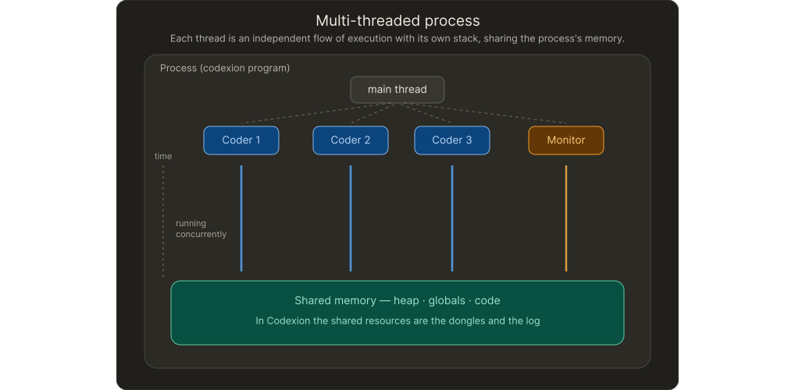
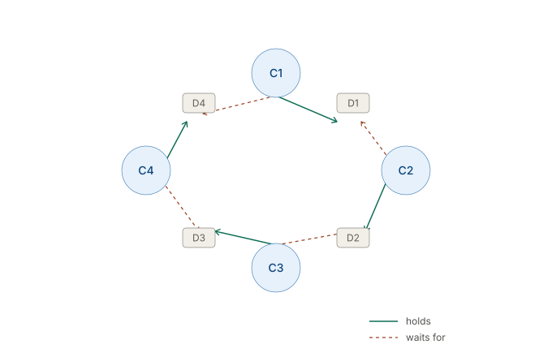

# Codexion

## Description

Codexion is a 42 school project consisting on solving Dijkstra's [**dining philosophers problem**](https://en.wikipedia.org/wiki/Dining_philosophers_problem) <a id="1">[1]</a> but with a *re-skin* and a few additions. The original problem is the following:

> Five philosophers dine together at the same table. Each philosopher has their own plate at the table and brings one fork, placed between each pair of adjacent plates. The dish has to be eaten with two forks, the ones placed on each side of the philosopher. Each philosopher can only alternately think and eat, thus two forks will only be available when their two nearest neighbors are thinking, not eating. After an individual philosopher finishes eating, they will put down both forks.

The solution requires a synchronization mechanism design so that philosophers can eat without causing **deadlock** (all waiting forever) or **die from starvation** (some never get a chance to eat) using multiple POSIX threads competing for limited resources, implementing correct synchronisation using mutexes and condition variables, and a scheduling algorithm.

Now, the re-skin of this classic exercise is that instead of philosophers we have **coders**, forks are **dongles**, eating is **compiling**, thinking is **debugging/refactoring**, and dying is **burning out**. The additions: there can be $N$ number of coders, dongles have a cooldown time and two scheduler types should be implemented for execution: FIFO and EDF.

### Key concepts:

#### Threads
*In computer science, a thread of execution is the smallest sequence of programmed instructions that can be managed independently.*[[2]](#2). A traditional process has a single thread of control, whereas if a process has multiple threads of control, it can perform more than one task at a time. All threads within a process share the same resources, but not with threads from other processes. In the context of Codexion, each coder represents a thread.



#### Mutex
When multiple tasks or threads access a shared resource without sufficient protections, it can lead to undefined or unpredictable behaviour. So to protect a thread from overwriting –or being overwritten by– other threads, we use a ***mutex*** ("short for mutual exclusion"), which is like a "lock" protecting a specific section of code that can only be executed by the lock owner until they unlock it. Every mutex has to be initialized for use and then destroyed after finished, otherwise it won't work.

#### Deadlock

*In an operating system, a deadlock occurs when a process or thread enters a waiting state because a requested system resource is held by another waiting process, which in turn is waiting for another resource held by another waiting process. If a process remains indefinitely unable to change its state because resources requested by it are being used by another process that itself is waiting, then the system is said to be in a deadlock.* <a id="3">[3]</a>. In Codexion, a deadlock occurs when each coder holds the dongle on their left and waits for the other one on their right. Since everyone does this at the same time, nobody can get their second dongle, blocking each other in a circular way. Like showed in the image below.


#### The scheduler (FIFO vs EDF)

The project requires to implement two different types of schedulers, FIFO and EDF, which will implement a policy for deciding which coder gets the dongle first based on a priority queue.

*FIFO (First In First Out)*:
The coder who requests the resource first is served first. Requests are handled in arrival order.

*EDF (Earliest Deadline First)*:
Priority is given to the coder that is closest to burning out, with the deadline being the last compile time + time to burnout.


## Blocking cases handled

Codexion has to keep several concurrency problems from breaking the simulation. Each one is handled as follows:

#### Deadlock prevention

A deadlock needs all four of Coffman's conditions to hold at once: *mutual exclusion*, *hold and wait*, *no preemption*, and *circular wait*. The one we break here is **hold and wait**: a coder never keeps one dongle while waiting for the other. It acquires both or neither, it takes its first dongle, immediately tries the second without blocking, and if the second isn’t free it releases the first and retries, holding nothing in between.

Because no coder ever sits holding a single dongle, the “each holds one and waits for another” chain a deadlock needs can never form. As a second, independent layer, the two dongles are still taken in a fixed global order (lowest id first), which rules out circular wait on its own — so two of the four conditions are broken, not one.

#### Starvation

No coder should wait forever for a dongle. Each dongle keeps a wait line (a priority queue), and the coder at the front is served first.

- Under **FIFO**, priority is the arrival order (a per-dongle ticket), so requests are served first-come-first-served and no coder can be skipped indefinitely.
- Under **EDF**, priority is the coder's burnout deadline, so the coder closest to burning out is served first. This is self-correcting: a coder that keeps waiting does not compile, so its last compile start stays old and its deadline stays early, which keeps pushing it toward the front of the line.

#### Dongle cooldown handling

After a coder releases a dongle, that dongle cannot be taken again until `dongle_cooldown milliseconds` have passed. On release we stamp the current time, and a waiting coder is only allowed to take the dongle once the cooldown has passed. This check is part of the condition a waiter re-evaluates on every wake-up, so a coder stays in the wait line until the dongle is both free and cooled down.

#### Burnout detection

A coder burns out if more than `time_to_burnout` milliseconds pass since the start of its last compile (or since the start of the simulation, if it has not compiled yet). A dedicated monitor thread checks every coder on a tight loop, sleeping only ~1 ms between passes, so a burnout is detected and logged well within the required 10 ms window. The monitor reads each coder's last compile start under that coder's mutex (see the next section), so the value it reads is never torn or stale.

#### Log serialization

All output passes through a single logging function guarded by one mutex (`log_mutex`), so two coders can never place characters on the same line. In addition, once the simulation has stopped, the logger suppresses any further normal state messages, so nothing is printed *after* a `burned out` line. The burnout line itself is printed by the monitor while holding `log_mutex` and setting the stop flag in the same critical section, which guarantees it is the last line of the run.

## Thread synchronization mechanisms

Codexion uses two POSIX primitives: **`pthread_mutex_t`** (mutual exclusion) and **`pthread_cond_t`** (waiting without busy-looping). Each piece of shared state has exactly one mutex responsible for protecting it.

#### Dongles: mutex + condition variable + wait line

Each dongle carries its own `mutex`, a condition variable (`waiters_sleep`), and a priority-queue `wait_line`. The dongle's mutex guards all of its state: whether it is held, when it was last released, and the wait line itself.

A coder that wants a dongle joins the wait line, then sleeps on the condition variable until it is allowed to take the dongle — meaning it is at the front of the line (by FIFO or EDF priority), the dongle is free, and the cooldown has passed. It waits with `pthread_cond_timedwait` on a short timeout so that it also wakes periodically to re-check the stop flag and never sleeps through the end of the run.

When a coder releases a dongle, it marks the dongle free, stamps the cooldown time, and calls `pthread_cond_broadcast` to wake every waiter so they can re-check whether it is now their turn.

#### Logging: one mutex over the output

All state messages are printed through a single function that holds `log_mutex` for the duration of the print. This serializes output across every thread so lines are never mixed together.

#### Coder - monitor communication: per-coder state mutex

The most important race to prevent is between a coder and the monitor. A coder **writes** its `last_compile_start` and `compile_count`; the monitor **reads** both from another thread. Both sides use the same per-coder mutex (`compile_state_mutex`), so the monitor always reads a consistent value.

This is how thread-safe communication between the coders and the monitor is achieved: the monitor never inspects compile state directly, only through these locked accessors.

#### The stop signal: a guarded flag

The whole simulation ends through a single `stop_flag`, protected by `stop_mutex` and only ever read or written through two helpers (`simulation_stopped` and `set_stop`). The monitor sets it on burnout or completion; every coder loop and every wait checks it, which lets the program always terminate cleanly.

#### Verifying race-freedom

Every shared variable is written and read under the same mutex, so there are no unprotected accesses. This was checked with **ThreadSanitizer** and **valgrind**, which reported no data races and no leaks across the tested scenarios.

## Instructions

### Compilation
The project features a Makefile that automates the compilation and building of the executable file for the project. So to compile, run:

```bash
make
```

### Execution
After compilation the executable file `./codexion` will be generated. Run the executable with the mandatory arguments:

```bash
./codexion number_of_coders time_to_burnout time_to_compile time_to_debug time_to_refactor number_of_compiles_required dongle_cooldown scheduler
```
Example:
```bash
./codexion 5 800 200 200 200 5 100 fifo
```
The schedulers implemented are `fifo` and `edf`.
Time values are expressed in milliseconds.

### Expected output
```bash
./codexion 2 200 100 100 100 5 100 fifo
0 1 has taken a dongle
0 1 has taken a dongle
1 1 is compiling
101 1 is debugging
201 1 is refactoring
201 2 burned out
```

### Other Makefile commands
```bash
make clean 		# deletes .o files but leaves the binary in place.
make fclean		# deletes the object files and the binary.
make re			# wipes everything and recompiles the whole project.
```

## Resources
#### **Documentation**
- <a id="1">[1]</a> [Dining Philosophers Problem - Wikipedia](https://en.wikipedia.org/wiki/Dining_philosophers_problem)
- [Codexion by Yassir El bakkari - Dev.to](https://dev.to/yel-bakk/codexion-4fk8)
- [Dining Philosopher Solution using Semaphores - GeeksforGeeks](https://www.geeksforgeeks.org/operating-systems/dining-philosopher-problem-using-semaphores/)
- [Philosophers 42 Guide “The Dining Philosophers Problem” - Medium](https://medium.com/@ruinadd/philosophers-42-guide-the-dining-philosophers-problem-893a24bc0fe2)
- <a id="2">[2]</a> [Thread (computing - Wikipedia)](https://en.wikipedia.org/wiki/Thread_(computing))
- <a id="3">[3]</a> [Deadlock (computer science)](https://en.wikipedia.org/wiki/Deadlock_(computer_science))
- [The gettimeofday() Function - C for dummies](https://c-for-dummies.com/blog/?p=4236)

#### **Videos**
- [Introduction to Threads - Neso Academy](https://www.youtube.com/watch?v=LOfGJcVnvAk)
- [Introduction To Threads (pthreads) | C Programming Tutorial](https://www.youtube.com/watch?v=ldJ8WGZVXZk)

#### **Peer repos**
- [mapadron](https://github.com/mpadronrz/codexion/tree/main)
- [josjimen](https://github.com/GuancheKing/03_codexion/tree/main)

#### **AI Usage**

Used Claude AI heavily throughout the project for the following:
- breakdown project into achievable testing milestones (reading, struct design, parsing, time and logging, simple threading, loop with mutexes, monitor with burnout, schedulers).
- design discussions.
- heap queue engineering and arithmetic.
- debugging.
- code review.
- final Linux container test pass.

